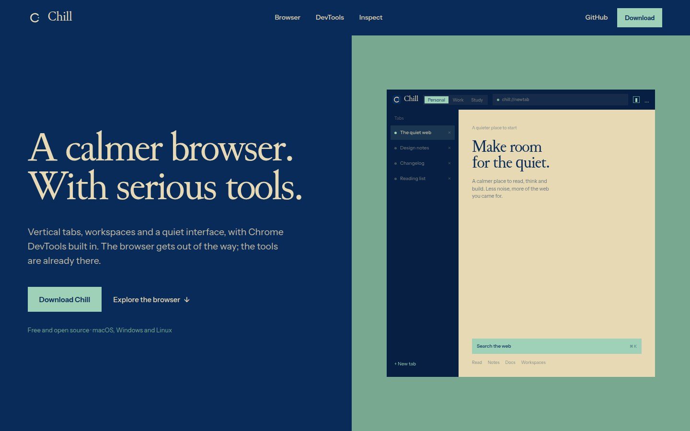

  
  <h1>Chill Browser — Website</h1>
  
<strong>The website for a calmer browser, with Chrome DevTools inside.</strong>

  

    <a href="https://github.com/chill-browser/desktop">Browser source</a>
    ·
    <a href="https://github.com/chill-browser/desktop/releases/latest">Downloads</a>
    ·
    <a href="https://zen-browser.app">Built on Zen</a>
  

This is the website for **Chill Browser**, a Zen-based browser with Chrome DevTools docked inside. It presents the browser, shows the DevTools panels, and points to the latest release.

## Downloads

The download button reads the latest GitHub release and picks the matching asset for the visitor's system. The current release ships Linux x86_64 and macOS Apple Silicon builds. Windows is not available yet.

The macOS build is unsigned, so the first launch asks for a right-click → Open. Python 3.7+ is required for the bundled Chrome DevTools frontend.
